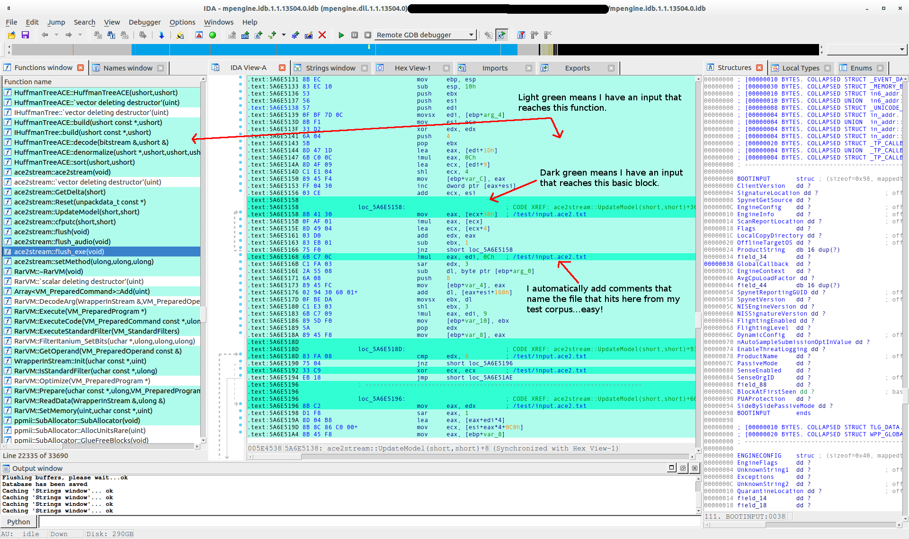

# Collecting Basic Block Coverage Data
## Introduction

This directory contains a simple pintool for collecting code coverage data, and
tools and scripts for processing that data. These tools can assist with corpus
distillation and anti-corpus auditing.

In it's simplest mode of operation, this tool simply creates a list of basic
blocks executed from the loaded DLL.

```
$ ./build/x86/coverage/pin -t build/x86/coverage/deepcover.so -- ./build/x86/mpclient eicar.com
main(): Scanning eicar.com...
EngineScanCallback(): Scanning input
EngineScanCallback(): Threat Virus:DOS/EICAR_Test_File identified.


----- COVERAGE ANALYSIS -----
         58590 Unique Instructions Executed
         10271 Unique Basic Blocks Executed
       3193230 Total Instructions Executed
        590362 Total Basic Blocks Executed
    Hottest Basic Block (0x00000000003918e7)
             11731 Executes
                 3 Instructions

$ wc -l coverage.txt
10271 coverage.txt
```

However, with some simple processing, we can produce annotated IDBs or create a
distilled corpus for fuzzing.



## Build

### Dependencies

Build the clients using the dependencies in the [main README](../README.md#dependencies).
The coverage tools additionally need:

| Fedora / RedHat       | Ubuntu / Debian    | Purpose                         |
| --------------------- | ------------------ |:------------------------------- |
| `libstdc++-devel.i686` | `g++-multilib`    | 32-bit C++ support for the Pin tool. |
| `pkgconf-pkg-config`  | `pkg-config`       | Finds GLib for `coverage_parse_min`. |
| `glib2-devel`         | `libglib2.0-dev`   | Builds `coverage_parse_min`.    |
| Intel Pin kit         | Intel Pin kit      | Download and unpack below.      |

On Ubuntu:

```
sudo apt install g++-multilib pkg-config libglib2.0-dev
```

Download an Intel Pin kit for gcc from the Pin download page and extract it
in the `coverage` directory.

* https://software.intel.com/en-us/articles/pintool-downloads

```
$ tar -xzf coverage/pin-external-4.4-99977-g54fbb8814-gcc-linux.tar.gz -C coverage
```

From the repository root, build both architecture-specific Pin tools and the
shared corpus distillation utility with:

```
$ make coverage
```

This creates `build/x86/coverage/deepcover.so`,
`build/x64/coverage/deepcover.so`, and `build/coverage/coverage_parse_min`.
The launchers are `build/x86/coverage/pin` and `build/x64/coverage/pin`.
`make all` builds the clients; the Pin tools require the separate `make coverage`
command. If the Pin kit is outside `coverage/`, pass `PIN_ROOT=/path/to/pin-kit`
to `make coverage`.

## Running

To create a list of all the basic blocks executed, simply do this:

```
$ ./build/x86/coverage/pin -t build/x86/coverage/deepcover.so -- ./build/x86/mpclient eicar.com
main(): Scanning eicar.com...
EngineScanCallback(): Scanning input
EngineScanCallback(): Threat Virus:DOS/EICAR_Test_File identified.


----- COVERAGE ANALYSIS -----
         58590 Unique Instructions Executed
         10271 Unique Basic Blocks Executed
       3193230 Total Instructions Executed
        590362 Total Basic Blocks Executed
    Hottest Basic Block (0x00000000003918e7)
             11731 Executes
                 3 Instructions
```

For the 64-bit engine, use the matching x64 tool and client:

```
$ COVERAGE_REPORT_FILE=coverage-x64.txt ./build/x64/coverage/pin -t build/x64/coverage/deepcover.so -- ./build/x64/mpclient_x64 eicar.com
```

The report is called `coverage.txt` by default, but you can override it by
setting the `COVERAGE_REPORT_FILE` environment variable.

If you have a directory of testcases you would like to generate coverage
reports for, you can use `xargs` like this:

```
$ ls samples
sample1.exe
sample2.exe
sample3.zip
...
$ find samples -type f | xargs -t -I{} -P8 -n1 env COVERAGE_REPORT_FILE={}.txt ./build/x86/coverage/pin -t build/x86/coverage/deepcover.so -- ./build/x86/mpclient {}
```

> The `-P` parameter to xargs specifies how many processes you can run in
> parallel. In general, set this to the number of cores you have available.

### Corpus Distillation

If you have a lot of inputs and want to find the minimal set cover for fuzzing,
first generate coverage reports for all your inputs.

```
$ find samples -type f | xargs -t -I{} -P8 -n1 env COVERAGE_REPORT_FILE={}.txt ./build/x86/coverage/pin -t build/x86/coverage/deepcover.so -- ./build/x86/mpclient {}
```

Use the matching x64 paths above to collect x64 reports. Keep x86 and x64
reports in separate directories when comparing or distilling corpora.

Now you can find a distilled corpus like this:

```
$ grep -H ^ samples/*.txt | awk -F: '{print $2FS$1}' | ./build/coverage/coverage_parse_min | cut -d: -f2 | sort -u
```

### Anticorpus Auditing

The "anticorpus" auditing technique is a simple idea, but nevertheless
experience suggests it can be effective on fuzz-clean software. The idea is to
build coverage data, then hilight codepaths that fuzzing isn't reaching.

A simple script to produce annotated idbs is included, generate coverage
reports for your inputs as above.

```
$ grep -H ^ *.txt | awk -F: '{print $2FS$1}' | ./build/coverage/coverage_parse_min | sed -e 's#:.*/#:#g' -e 's/.txt$//' > minimal.txt
$ bash coverage/genidc.sh minimal.txt > coverage.idc
```

Now you can load this file in IDA with `File->Script File...`.

## Limitations

On some Linux kernels, Pin 4.4's 32-bit tool stops before the client starts
with `INS_SyscallType: Unknown system call instruction`. The kernel setting
`abi.vsyscall32` controls whether it maps the 32-bit vDSO into 32-bit processes:
`1` enables it and `0` disables it. Disabling it allowed the x86 coverage run
to complete on the native Linux VM. The x64 tool does not need it.

Run the following from the repository root. The
subshell saves the current setting and restores it when Pin finishes, even if
the scan fails. The setting affects other 32-bit processes started in the VM
while the scan runs.

```
(
    set -e
    previous=$(cat /proc/sys/abi/vsyscall32)
    trap 'sudo sysctl -q -w abi.vsyscall32="$previous"' EXIT
    sudo sysctl -q -w abi.vsyscall32=0
    ./build/x86/coverage/pin -t build/x86/coverage/deepcover.so -- ./build/x86/mpclient /bin/true
)
```

## Notes

* The pintool only starts collecting coverage data once you've called `InstrumentationCallback()`.
* You can blacklist blocks you don't want instrumented by listing them in `blacklist.h`.

## License

GPL2

